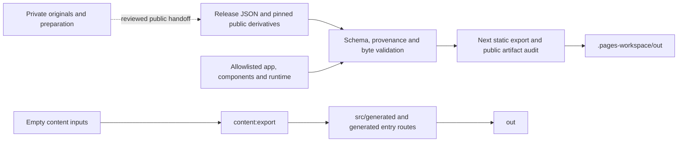

# JosHsuan Chao — portfolio architecture

A static portfolio with native editorial pages, source-backed project studies,
and optional 3D/media presentation. The public site is
[**joshsuan.github.io**](https://joshsuan.github.io/).

This repository contains **two independent applications**. The selected public
application lives in the Bending-Active case workspace; the reusable `src/`
framework intentionally contains no personal projects or registered scenes.
The latest refinement is governed by [decision 0019](docs/decisions/0019-portfolio-refinement-and-runtime.md)
and its [integration and acceptance record](roles/uiux-designer/cases/bending-active-thesis/PORTFOLIO_REFINEMENT_INTEGRATION.md).
Implemented source, local acceptance and a deployed release are separate facts;
the public [`release.json`](https://joshsuan.github.io/release.json) identifies
the deployed commit and source revisions.

## System boundaries

| Application | Source and purpose | Build output |
| --- | --- | --- |
| Selected public portfolio | `roles/uiux-designer/cases/bending-active-thesis/{app,components,runtime,release}`. Home, About, Project, Contact, Bending-Active, XR and six further project studies. | `pnpm build:pages` → `.pages-workspace/out/` |
| Reusable framework | `src/` and empty `content/` inputs. Typed content/motion contracts, generated entry templates, scene loading/fallbacks and an empty scene registry. | `pnpm build` → `out/` |
| Specialist workspaces | Twelve existing roles under `roles/`: source preparation, design research, local tools and verification. Only explicitly allowlisted case files enter the public build. | Separate opt-in tools; see the [role index](roles/README.md). |

Both applications use Next.js static export with trailing-slash routes. The
public site needs no request-time Node server, database, CMS or account service.
Native document links preserve direct loading, browser history and resource
lifetimes. Text, captions, credits, source links and poster alternatives remain
HTML; understanding a project does not require WebGL or completing an animation.

The primary stack is Next.js/React and Three.js; Bending uses a demand-rendered
React Three Fiber scene, while the generic studies and XR have their existing
imperative rendering adapters. Exact dependencies are in
[package.json](package.json) and [pnpm-lock.yaml](pnpm-lock.yaml).
The framework contains a Theatre adapter under `src/motion/theatre`; this does
not mean the selected public application runs an authored Theatre timeline.
Its current choreography uses the checked-in project samplers/presenters.
Studio remains local-only and is rejected from production bundles.

## Content and public asset pipeline

Software architecture and executable contracts are maintained here. Original
portfolio documents, CAD, footage and content preparation remain in the
owner-designated preparation workspace described in
[architecture Sections 00 and 12](docs/architecture.md#00-current-project-baseline-and-source-authority).
Normal builds never scan that workspace or require a private drive.



[`release/manifest.json`](roles/uiux-designer/cases/bending-active-thesis/release/manifest.json)
pins public bytes and source-record hashes. Story/introduction/contact JSON,
XR records and `project-studies.json` supply the selected application;
`project-assets.json` records the reviewed derivatives and provenance.
[`build-pages.mjs`](scripts/build-pages.mjs) verifies that handoff, copies only
explicitly allowed source/assets into a generated workspace, builds once and
runs [`audit-pages.mjs`](scripts/audit-pages.mjs). Image/model/media validators
check the declared dimensions, source geometry and native timing where relevant.
Original documents, drafts, SQL, private paths and raw review records are not
browser inputs. Publicly delivered assets are downloadable; a viewer is not a
confidentiality boundary.

The framework's separate `content:export` validates repository-local `content/`
and writes `src/generated/public-content.json` and `src/app/(entries)`.
**Never edit generated entry routes manually.** Empty inputs generate no
fictional projects or detail slugs. Do not modify either generated output
folder as an implementation source.

English is the maintained documentation and public UI language. Owner
conversations use Traditional Chinese; original evidence retains its source
language, labels and credits.

## Runtime building blocks and event flow

Presentation has three ownership domains: the shared CSS/vignette/Canvas 2D
atmosphere, native content/information surfaces, and each project's own 3D or
recorded evidence. [The background contract](roles/uiux-designer/cases/bending-active-thesis/GLOBAL_BACKGROUND_INTEGRATION.md)
and [architecture review](roles/uiux-designer/cases/bending-active-thesis/PORTFOLIO_ARCHITECTURE_REFACTOR_REVIEW.md)
describe their boundaries.

| Building block | Responsibility |
| --- | --- |
| `GlobalBackground` / `BackgroundRuntime` | One exclusive Layer 1 lease per document. The service owns no camera or clock. Bending delegates it to its existing Director; ordinary pages use `SiteBackgroundDriver`. |
| `SiteNavigation`, `SiteReadiness`, preview readiness | Native document handoff and bounded font/image/required-preview readiness. A verified first draw or explicit static terminal precedes optional enhancement; timeout/failure never fabricates readiness. |
| `SiteBackgroundDriver` | Existing ordinary-page demand scheduler for atmosphere, Home/six-case reading response, glass and generic project source presentation. No separate generic chapter or media animation loop. |
| `ProjectStudyChapterPresenter` | One six-case semantic chapter owner. Layout invalidation caches fractional native section anchors; the current viewport midpoint selects chapter intent, rail and counter before source presentation. Native pause owns one intent and truthful controls. |
| `ProjectStudyBackdropPresenter` | One generic image/video/model source transaction: exit → prepare → enter → hold, with explicit supersession/failure closure and actual decode/paint gates. |
| Stage registry / scene presenter / Three adapter | React registers a native host; the project owner manages preparation and inspection; the renderer alone writes the source model and final camera. Off-chapter ready resources are retained, then disposed on actual departure. |
| Bending runtime / `ExperienceDirector` | Closed feature registration, validated commands/discrete state, native reading and its existing chapter/frame orchestration. Continuous values stay outside React state. |
| `XRStageDirector` | XR's existing project-local stage, inspection and reading presentation. It does not write the ordinary driver's Layer 1 background or native video time. |
| `EventManager`, `DisposableScope`, `DOMPresenter` | Scoped registration/cleanup and owner-specific DOM publication that suppresses unchanged writes. These services do not choose narrative or create another clock. |

On the six generic pages, native scroll/anchors invalidate the existing demand
frame. A layout change refreshes cached anchors; the single chapter result then
feeds the source transaction. Reading is immediate even while a new source is
preparing. Wheel/touch observation stays passive until a real model hit commits
an inspection gesture; vertical touch movement remains native document reading.
Keyboard inspection and return controls provide equivalent access.

One writer owns each camera/property. Each established presentation owner keeps
its existing demand scheduler; Bending substitutes its Director for the ordinary
background driver, and XR retains its separate project-stage ownership. No new
clock is introduced by the six-case chapter refactor. **Native video owns media
time**: scrolling chooses a source, not its playback position. Pause, finite
end/replay and retained per-recording time remain native transport facts.

Hidden/frozen and persisted pagehide states compose suspension reasons, cancel
outstanding frame work and stop media without replaying elapsed hidden time.
BFCache restoration reuses retained resources and refreshes native layout.
Nonpersisted departure disposes listeners/observers, pending acquisition,
callbacks/deadlines, native media sources, render resources and the background
lease. Reduced motion, Save Data, failed WebGL/media and no-JavaScript reading
retain meaningful static material.

## Development and verification

Use **Node 24.19.0**, **pnpm 11.19.0** and the committed lockfile. See
[toolchain](docs/toolchain.md) and [compatibility](docs/compatibility.md).
Install once from the repository root:

```sh
pnpm install --frozen-lockfile
```

For the selected public application:

```sh
pnpm build:pages
node scripts/serve-pages.mjs
```

Open `http://127.0.0.1:4186/`. The preview serves the exact built files, including
native MP4 byte ranges. In another terminal, or with the test-managed server:

```sh
pnpm exec playwright install chromium webkit
pnpm test:pages
```

Set `THESIS_REUSE_SERVER=1` when deliberately testing an already running preview;
otherwise Playwright starts its own server. Tests target the built export,
not a development server.

| Command | Actual scope |
| --- | --- |
| `pnpm check` | Framework content/lint/types/unit tests, CI selector/gate tests, framework export and artifact audit. Does not replace the public-case suites below. |
| `node --test roles/uiux-designer/cases/bending-active-thesis/tests/*.test.mjs roles/uiux-designer/tools/*.test.mjs` | Portable case/runtime/source/tool contracts. Report intentional skips separately. |
| `pnpm build:pages` / `pnpm audit:pages` | Complete selected public export and its source/output boundaries; the latter audits existing output. |
| `pnpm test:pages` | Built public Chromium, WebKit and mobile Chromium journeys; one worker, no retries. |
| `pnpm dev` | Empty framework development at `http://127.0.0.1:3000/`. |
| `pnpm build` / `pnpm preview` | Empty framework static export and preview at `http://127.0.0.1:4173/`. |
| `pnpm exec playwright install chromium firefox webkit` / `pnpm test:e2e` | Built framework browser checks; CI tests root and simulated subpath exports. |

Root ESLint intentionally excludes isolated role workspaces; changed case runtime
files also need explicit scoped lint, as recorded in the architecture review.
For a framework project-site export, `NEXT_PUBLIC_BASE_PATH` accepts one
`/repository-name`; leave it empty for the canonical user site. The selected
public build uses its own verified root-route configuration.

## CI, publication and evidence

[`ci.yml`](.github/workflows/ci.yml) selects the union of affected checks from a
validated ancestor. Shared/unknown inputs widen coverage. Documentation-only
changes still validate selection/gate logic but create no new publishable app
artifact when that computed scope is genuinely documentation-only.

A public candidate is built once as `static-export-pages`; browser jobs download
and verify that same complete output before and after testing. The required
gate validates selected aggregate job results and records the commit, plan and
output digest. Structured per-test receipt enforcement is not yet part of that
gate; the separate release audit checks actual execution coverage.

The owner-authorized [`deploy-pages.yml`](.github/workflows/deploy-pages.yml)
accepts a successful default-branch **push** validation run for the **same commit**.
It verifies the validated record/output digest and publishes those tested bytes
without rebuilding. A successful documentation/framework-only run cannot supply
a new public application release. After publication, check `release.json`, route
and asset bytes, native media delivery and desktop/mobile user journeys.
[CI/CD operations](docs/CI_CD.md) documents the procedure;
[the DORA-informed plan](docs/CI_DELIVERY_PLAN.md) separates implemented safeguards
from proposed faster feedback, coverage receipts and recovery improvements.

Green source tests, browser simulations, a human image review, CI, deployment
provenance and live acceptance establish different things. Current candidate
results and remaining work belong in the
[refinement contract](roles/uiux-designer/cases/bending-active-thesis/PORTFOLIO_REFINEMENT_INTEGRATION.md),
[team review](roles/uiux-designer/cases/bending-active-thesis/PORTFOLIO_REFINEMENT_TEAM_REVIEW.md)
and [performance review](roles/uiux-designer/cases/bending-active-thesis/PORTFOLIO_PERFORMANCE_REFINEMENT_REVIEW.md).
Do not infer a new release from this README or reuse an older candidate's counts.
Physical iPhone/Safari stability remains unverified; mobile emulation and
synthetic context loss do not prove it. Recorded software-rendered lab stalls
are not field INP, hardware performance or a resolved crash.

## Architecture references and further reading

This README uses a compact [arc42](https://github.com/arc42/arc42-template)-inspired
context/building-block/runtime/deployment structure, adapted to the actual code.
It does not introduce an architecture framework dependency.

| Primary reference | Application here |
| --- | --- |
| [Next.js static export source](https://github.com/vercel/next.js/blob/canary/docs/01-app/02-guides/static-exports.mdx) | Build-time HTML/routes and explicit browser-only setup; no request-time server assumptions. |
| [React effect guidance](https://github.com/reactjs/react.dev/blob/main/src/content/reference/react/useEffect.md) | External-system setup has mirrored cleanup; derived chapter state has one owner. |
| [MDN listener source](https://github.com/mdn/content/blob/main/files/en-us/web/api/eventtarget/addeventlistener/index.md) | Explicit listener identity/lifetime and passive native observation, implemented through tested local scopes. |
| [Chrome Page Lifecycle implementation](https://github.com/GoogleChromeLabs/page-lifecycle/blob/master/src/Lifecycle.mjs) | Retained hidden/frozen/BFCache lifetimes differ from permanent disposal. |
| [Chrome Web Vitals guidance](https://github.com/GoogleChrome/web-vitals/blob/main/README.md) | Bounded measurement lifetimes and honest separation of lab observations from field metrics. |

[Architecture](docs/architecture.md) retains detailed implemented mappings and
clearly labelled proposals. [Website design guidance](docs/WEBSITE_DESIGN_GUIDELINES.md)
sets presentation/content priorities. [Decision 0001](docs/decisions/0001-empty-framework.md)
protects the empty reusable framework; [the decision log](docs/decisions/)
retains earlier scope and rationale. Specialist research, private preparation
and installed-but-unused adapters are not evidence of active public features.
