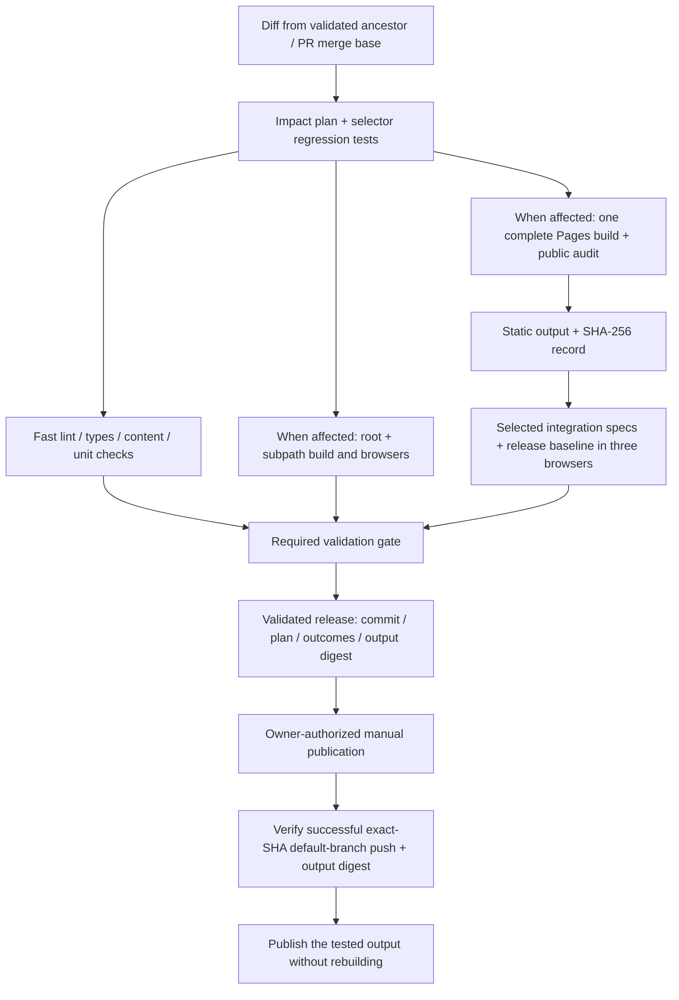

# CI/CD validation and publication

The repository has two independent exports: the empty reusable framework (`out/`) and the public Bending-Active case (`.pages-workspace/out/`). [Decision 0009](decisions/0009-impact-selected-ci.md) defines the owner-authorized impact-selection policy. Node 24.19.0, pnpm 11.19.0 and the frozen committed lockfile remain mandatory.

The [DORA-informed CI and delivery plan](CI_DELIVERY_PLAN.md) records the owner's research request, the 20 October official-source review, the fast-feedback objective, current capacity evidence, an ordered implementation backlog with completion criteria, and production delivery metrics. Its [current planning decision](CI_DELIVERY_PLAN.md#current-planning-decision--20-october-2026) distinguishes implemented jobs from proposed timing/coverage receipts, duration balancing, native smoke and recovery work. This file describes implemented operation; planned stages do not replace the current release gate.



## Selection rules

| Changed inputs | Required scope |
|---|---|
| README/AGENTS, documentation Markdown outside content/public asset inputs | Selector/gate tests and plan; expensive jobs skipped; no publishable output. |
| Known framework source/content/public files and framework test/export tools | Fast checks, root and simulated-subpath builds/audits and all framework browser projects. |
| ModelInspector, model information/CSS or ModelManager | Release baseline; model inspection, native mouse/touch drag, canvas interaction, source artwork/diagram synchronization, lifecycle and mobile stability. |
| Evidence inspector or EvidenceManager | Release baseline, source artwork and motion/reading feedback. |
| SourceDiagram/CSS or DiagramManager | Release baseline, source artwork, library line reveal, model inspection and canvas interaction. |
| ReadingManager or its response tests | Release baseline, motion/reading feedback, canvas interaction, source artwork and model inspection. |
| Event/core/contracts, Director, SceneRuntime, app/global layout, camera/material/render modules, assets, or other unmapped case inputs | All case portable tests and browser specs; root framework remains independent. |
| Shared browser helper/configuration | All case browser specs. A changed individual spec runs itself plus the release baseline. |
| Package/lockfile, shared tooling/build/cache/CI changes, or unknown non-case input | Full framework and case validation. |

The implementation is [ci-impact.mjs](../scripts/ci-impact.mjs). Multiple changes select a union. Newly introduced paths default to the wider scope; update the map only with evidence of the feature's integration boundaries. Git diffs disable rename detection so both old and new paths contribute to selection. Markdown under content or release public assets is never classified as documentation-only.

Every case candidate runs the **whole audited public build**, complete cheap portable tests, and `public-release.spec.mjs` on Chromium, WebKit and mobile Chromium. The baseline covers semantic/no-JavaScript reading and linked assets, Full model initialization/navigation, evidence keyboard focus and reduced/failure fallbacks. The entry-readiness service and library presenter/sampler conservatively select the full case. Feature selection reduces additional expensive browser checks; it does not publish a partially built website.

Push selection uses the last successful **ancestor push run**, not `event.before`. This includes all cumulative changes since success, including failed/cancelled runs. Missing ancestry, no successful history, or a failed baseline query causes full validation. PRs use the base/head merge base. A manually dispatched run defaults to full validation; turning off its `full_validation` input uses the same successful-ancestor selection, but manual/PR runs do not satisfy publication provenance.

## Build reuse and caches

`quality` runs fast checks once. `pages-build` creates/audits a new export once and uploads `static-export-pages` plus `pages-build-record`. Case browser jobs download that exact export; each verifies its digest before and after tests. Only the required browser engine is installed. Full-case Chromium uses four file-level shards; full-case WebKit and mobile Chromium each use two. Scoped checks use one shard per browser. Every runner retains `workers: 1` to limit software-GPU contention. The browser-job ceiling is 45 minutes from `ddafd44`: the preceding 30-minute ceiling cancelled the final case while it remained inside its original scenario deadline. All assertions and individual deadlines remain unchanged. This is a bounded capacity repair; the DORA-informed fast-feedback target is documented separately.

The pnpm store cache uses the lockfile. Next cache keys separate framework root/subpath and Pages, with a lockfile-scoped restore prefix and a commit-specific save key. [prepare-pages-workspace.mjs](../scripts/prepare-pages-workspace.mjs) preserves only `.next/cache`; app sources, public files, server output and old exports are removed before assembling the allowlisted build. Cache hits are an optimization, never validation evidence or a reusable deployed output.

Superseded CI runs in the same event/ref concurrency group are cancelled. Manual publishing keeps its non-cancelling Pages concurrency group. Runner scheduling and rendering cost affect elapsed time; duplicate-work reduction is not a guarantee of an equivalent wall-clock reduction.

## Gate and release procedure

`Required validation gate` runs after all job outcomes, including failures/skips. A selected job must report success; an excluded job must report skipped. A failed plan or missing build record fails the gate. The `validated-release` artifact contains `ci-validation.json` with the plan, exact commit/run/event/branch, required results and complete static output digest, including hidden files.

The checked-in gate validates aggregate job outcomes; it does not yet collect structured per-test receipts or enforce an expected test-ID union itself. The separate release audit records that union for full candidates. Moving this check into CI, with candidate-bound evidence and negative regression tests, is a planned improvement in the DORA plan. Existing conservative scoped acceptance remains valid under the selection rules above.

1. Run `pnpm check`, `pnpm test:ci`, case portable tests and the appropriate browser checks against built output locally. For architecture changes, retain the required root check even when a later documentation-only CI push would skip it.
2. Commit and push. Inspect the workflow's plan and required gate. This CI migration and the current shared runtime changes intentionally select **full** validation.
3. Dispatch `Publish reviewed Pages artifact` at the selected default-branch commit with its successful push `validation_run_id`.
4. The deployment workflow checks run provenance, downloads that run's output and validated record, checks every output byte plus `/release.json` against the selected SHA, then uploads/deploys without building again.
5. Verify the public `/release.json`, home page and linked scripts. Record CI/deployment run URLs in the delivery report; do not generate another release merely to add a post-release note.

Documentation/framework-only successful runs have no public case output and cannot be dispatched as a new case release. Deployment continues to reject PR/manual validation runs, mismatched commits, unsuccessful required checks and changed output. Historical validation runs predating this record cannot use the new deploy workflow; use the new successful push artifact.

Local commands:

```sh
pnpm test:ci
pnpm check
node --test roles/uiux-designer/cases/bending-active-thesis/tests/*.test.mjs
pnpm build:pages
pnpm test:pages
```

To inspect a targeted plan locally, set `CI_BASE_SHA` to a verified ancestor and run `node scripts/ci-plan.mjs`; set `CI_FORCE_FULL=true` to force every check. The local diff covers committed history. To inspect uncommitted inputs, pass their paths to the exported `classifyChanges` function, including untracked files. Generated plan/build/validation JSON files are ignored.

## Verification limits

### Materials/event integration capacity — 15 October 2026

At that checkpoint, the preceding successful `1d0bd9f` release ran 45 identical scenarios per public browser, 135 total. Hosted mobile Chromium took 26.1 minutes and WebKit 19.9 minutes. Full-case WebKit/mobile were changed to two file shards each to accommodate the new integration checks within the then-current 30-minute job limit. Chromium retained four shards; scoped checks remained unsharded. Scenario union and artifact identity remained required. This was workload partitioning, not a claim of faster rendering or weaker acceptance.

### Local migration checkpoint — 13 October 2026

- `pnpm check` passed on the final source, including 9 framework tests, 13 CI regression tests, lint/types and the 63-file empty-framework build audit. `actionlint` 1.7.12, downloaded from its official release and checksum-verified, accepted both workflows.
- Case portable checks passed: 210 tests, 2 conditional skips. The complete public build audited 80 local output files and all 36 approved assets. Workspace-cache regression tests prove stale public/output removal and compiler-cache retention; compiler-cache speedup has not been measured.
- Built-root and built-subpath Chromium/WebKit/mobile-Chromium checks passed: 9 each. Firefox was not run locally; both hosted framework matrices continue to require it.
- The broad local case run completed 35 Chromium checks, then exposed an obsolete footer selector in the contrast scenario. It was stopped during the subsequent WebKit run after correcting that selector. The repaired contrast scenario passed on all three projects against the same public output. It measures the new fixed side information over real, white and black backdrops; no assertion was removed. An uninterrupted complete local three-browser matrix is not claimed.
- Playwright listing confirms full-case Chromium shards contain 19 and 17 tests, covering all 36 Chromium scenarios. The release still requires the complete hosted 108-scenario case matrix and both framework matrices to succeed at the pushed commit before deployment. CI/deployment URLs and public-version verification belong in the delivery record.

### Full-mode partition checkpoint — 14–15 October 2026

The Full-mode suite contained 45 scenarios per browser at that checkpoint. At commit `37d3728`, hosted Chromium shard `1/2` completed 20 of its 24 scenarios and began scenario 21 before the then-current 30-minute job limit cancelled it. The log records cumulative execution time rather than an assertion failure. All other selected jobs passed; this incomplete run cannot satisfy the publication gate.

Playwright listing showed that three file-level shards would still group the first 21 scenarios together (21/10/14), including both model inspection and the costly canvas/library scenarios. Four shards separate those files and contain 12/12/12/9 scenarios. An exact test-ID union check confirms all 45 Chromium scenarios occur once, with no file split across shards. The 14 selector/gate regression tests also pass.

At that checkpoint, full-case Chromium was therefore split across four separate runners, preserving complete files and their local sequences. Scoped Chromium remained unsharded. All 45 scenarios still ran on each of Chromium, WebKit and mobile Chromium, with one worker per runner and the same audited output verified before and after every browser job. A successful exact-commit hosted gate remained required before publication. The 13 October counts above remain historical; that partition did not claim a hosted runtime improvement before measurement.

Selector/gate tests include cumulative Git histories, rename paths, scope unions, failed/skipped jobs, cached stale-output removal and changed artifact bytes/provenance. Functional browser assertions are unchanged by CI selection. Local Windows browser checks and hosted Linux checks are distinct evidence. Physical iPhone/Safari and Android verification remains unperformed; no device crash resolution or frame-rate improvement is implied. Time savings will be reported only from comparable measured runs.

Official references: [GitHub dependency caching](https://docs.github.com/en/actions/reference/workflows-and-actions/dependency-caching), [workflow dependencies and conditions](https://docs.github.com/en/actions/reference/workflows-and-actions/workflow-syntax), [Next.js compiler caching](https://nextjs.org/docs/pages/guides/ci-build-caching), [Playwright sharding](https://playwright.dev/docs/test-sharding).
