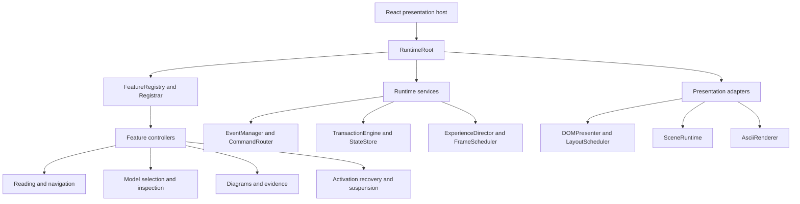
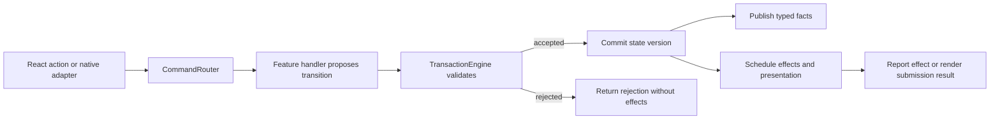
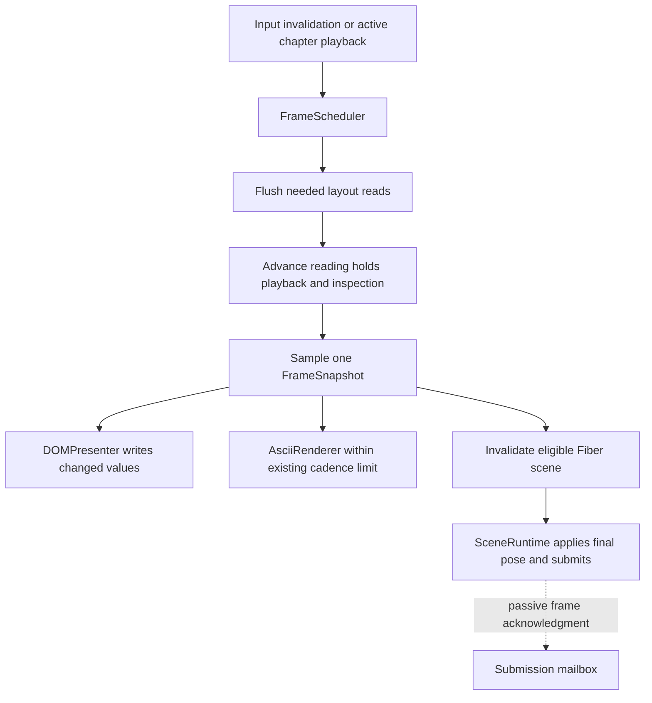

# Bending-Active runtime architecture proposal

Date: 10 October 2026, Europe/Berlin. Status: design with an owner-authorized local implementation. The [staged verification record](RUNTIME_REFACTOR_VERIFICATION.md) identifies accepted artifacts, measurements and remaining checks; publishing is separate.

The proposed runtime separates event infrastructure, feature behavior, committed application state and frame presentation. It combines the [event architecture research](EVENT_ARCHITECTURE_RESEARCH.md) with the [advanced runtime patterns](ADVANCED_RUNTIME_PATTERNS.md), while retaining the current chapter timing, source assets, visual behavior and static release boundary.

## Local implementation mapping

The owner-selected Plan B follow-up on 12 October 2026 makes the active reader native: visual/document reading positions match, the director supplies no paragraph/media hold points, and CSS/DOM publication no longer compensate the entire article's scroll position. Scene chapter holds and playback remain independent. Existing damped reading functions are retained as historical opt-in samplers, rather than the active reader. Native input velocity/energy still inform rendering-pressure classification and have no deceleration tail. This follow-up is a local review change.

The implementation remains inside the existing case. React views use `ExperienceProvider.jsx` and `RuntimeRoot.mjs`; typed contracts and core services are under `runtime/contracts` and `runtime/core`. The five feature factories live in `runtime/features`, the director in `runtime/orchestration`, and scene/editorial/DOM/layout adapters in `runtime/presentation`. Existing pure samplers, `runtime-scheduler.mjs`, the compositor and `page-field-renderer.mjs` remain the executable frame/render algorithms.

- The closed catalog registers factories and their required services. Mounted views connect their real feature work through the Registrar. Module imports create no browser listeners, timers or GPU resources.
- Current typed commands are `preferences.apply`, `quality.set`, `model.interact` and `model.select`. The broader command vocabulary below describes the design, not additional implemented handlers. Native navigation, pointer capture, focus and cancellation retain synchronous feature boundaries.
- Discrete validated state and latest frame data have different stores. React remains the owner of markup and discrete controls; chapter-driven DOM publication uses DOMPresenter. Feature-specific ARIA announcements, source labels and scene-caption adaptation keep their existing narrow native presentation boundaries.
- Registrar stop releases connections and permits React effect reconnection; permanent disposal closes the kernel. Both startup rollback and disposal continue releasing other resources when one cleanup throws, then report the collected errors.
- ExperienceDirector creates the one existing chapter scheduler. Fiber uses demand rendering; SceneRuntime is the final camera/object writer. The independent 2D page field consumes director time and owns no timer.
- Actual decorators, an actor framework, diagnostic replay and a render graph remain optional later work. This implementation uses explicit descriptors and the existing compositor.

The target folder and responsibility descriptions below remain the design reference. They do not imply a new file for every conceptual service or a live backend.

## Runtime structure

The following diagram shows responsibilities and composition. The command and frame diagrams below define execution order.



- **React host:** keeps the readable HTML, controls, portals and discrete UI state bindings. A client lifecycle hook creates, starts and disposes one runtime instance. Server/build rendering has no browser or GPU side effects.
- **RuntimeRoot:** is the composition root. It provides the event infrastructure, state, clock, storage and asset ports, and connects the presentation adapters. It contains assembly code rather than feature behavior.
- **FeatureRegistry:** stores explicit feature descriptors: ID, required services/features, factory, command/event declarations and lifecycle hooks. Registration does not start a feature.
- **Registrar:** checks duplicate IDs, missing dependencies and cycles; creates instances, binds handlers and owns their scopes. It starts dependent features in order and rolls back partial startup in reverse order. HTML readiness does not wait for optional WebGL initialization.
- **EventManager:** manages typed fact channels, global browser listener registrations, subscription handles and bounded diagnostics. Feature-owned emitters expose narrow subscription interfaces to consumers. It does not compute model poses or decide chapter policy.
- **CommandRouter:** routes each command to one registered handler. Its acceptance path is synchronous when native pointer capture, focus or event cancellation depends on the result. Asset/effect completion is a separate asynchronous result.
- **TransactionEngine:** validates a proposed transition against state ownership and interaction constraints, then commits one versioned snapshot. Only an accepted transition publishes facts and effect requests.
- **StateStore:** retains current discrete application state and selective subscriptions. Joining consumers can obtain a current snapshot without replaying event history.
- **ExperienceDirector:** owns the shared chapter clock and cross-feature presentation policy. It coordinates the update phases and camera-mode rules, rather than registering raw DOM listeners or loading assets.
- **FrameScheduler:** adapts the existing scheduler's coalescing and suspension behavior. Fiber retains its separate demand-render mechanism; the application has one chapter time authority.
- **LayoutScheduler:** collects explicit invalidations from resize, fonts, media, disclosures and scene availability. It batches DOM reads before dependent writes and respects natural document anchors.
- **SceneRuntime:** owns Three.js resources, renderer attachment, final camera/object writes, optical submission and budget enforcement. Renderer allocation guards must be installed in the renderer factory before Fiber sizing.
- **AsciiRenderer:** draws the existing optional bounded 2D field using the director's time. It owns no autonomous timer.

## Feature ownership

- **ReadingManager** handles chapter navigation, hash/history restoration and focus intent. It owns navigation state and supplies natural reading information to the frame pipeline.
- **ModelManager** validates representations and handles exact source hits, inspection begin/end and view targets. Continuous drag targets live in the frame input buffer. It receives hit-test/query interfaces, not a mutable camera.
- **DiagramManager** owns source-diagram interaction and highlighting. It issues selection commands and observes accepted selection/presentation facts.
- **EvidenceManager** owns figure expansion, close behavior and focus return. Expansion explicitly invalidates layout.
- **LifecycleManager** owns activation/loading/failure/recovery transitions, cancellation generations and the session lease. It also reports independent suspension reasons to the director.

Existing pure reading, chapter, inspection, optical and choreography samplers remain functions. Feature controllers can be factory-created objects; inheritance and classes are optional.

## Command and event flow



- Example commands: `chapter.navigate`, `model.select`, `inspection.begin`, `inspection.end`, `motion.setPaused`, `quality.set` and `scene.enable`.
- Example facts: `navigationChanged`, `representationChanged`, `inspectionChanged`, `sceneStatusChanged` and `layoutInvalidated`.
- A model-selection handler can propose a representation, its associated chapter request and inspection release together. Commit succeeds only if that combination is valid.
- Native `preventDefault`, focus and pointer capture remain synchronous at the browser boundary when required. Passive touch listeners preserve native scrolling. A universal asynchronous queue must not delay those browser operations.
- A fact subscriber may request another command, but reentrant state changes are deferred until the current publication completes. This ordering is explicit and tested.
- State transactions cover logical state. They cannot roll back network requests, a GPU submission or already-performed DOM changes.
- `representationChanged` means an accepted logical change. A rendered-frame submission has a separate passive acknowledgment; it does not mean that pixels are physically visible on the device. The acknowledgment must not notify subscribers or schedule itself into a loop.

## State and frame data

- **Committed application state:** source selection, inspection ownership, requested navigation, Full/Light preference, explicit pause, system reduced-motion preference and scene status. A transition increments the state version once.
- **Scene status:** `disabled`, `loading`, `ready`, `failed` and permanent runtime disposal. Loading failure and manual retry rules remain separate from visibility and pause.
- **Suspension state:** a set of independent reasons such as visibility, page lifecycle and freeze. Removing one reason cannot resume a runtime still suspended for another reason.
- **Frame input buffer:** latest pointer, native scroll position, drag target and accumulated input impulse. Pointer positions can be coalesced; discrete clicks and navigation requests retain order.
- **Frame working state:** playback time, damping/inspection responses, chapter holds and pressure measurements. These remain controller-owned mutable values.
- **FrameSnapshot:** coherent sampled presentation data containing frame ID, state version, information chapter, scene chapter, pose parameters, lighting/optics and field cues. It is consumed directly by views, not routed through React state each frame.
- **Scene resources:** geometry, materials, textures, cameras and targets stay inside SceneRuntime. They do not enter serializable application snapshots.

Information and scene chapter probes retain their different meanings. A direct source selection can request its associated scene without making every information update override scene placement.

## Frame execution



- The director reads the submission mailbox during an already-needed update. Entry reveals can wait for the required chapter/frame submission; the mailbox itself creates no scheduling loop.
- DOM and ASCII consume the same sampled frame independently of when Fiber submits its demanded frame. No GPU readback or synchronous rendering wait is introduced.
- Pure samplers calculate competing story/inspection contributions. Only SceneRuntime combines and applies the final camera pose. It also owns final model transforms.
- Continue scheduling only while playback, settlement, a deliberate response or required reveal is active. Settled Pause/hidden operation has zero ongoing controller, scene and field work.
- MAKE/VALIDATION retain their current heavy-scene absence. The independent page field and readable HTML can continue under their existing policies.
- Retain the current physical pixel budgets, touch/iOS profile, stable height handling and source-support fitting. Architectural organization does not authorize changing these visual/resource contracts.

## Registration and decorators

- Module imports define descriptors without installing browser listeners, starting timers or creating GPU resources.
- Startup follows **define descriptors → validate dependencies → instantiate → bind → start**. Each feature receives a disposable scope and narrow context.
- A scope owns subscriptions, native listeners, observers, effect cancellation and teardown callbacks. Closing it is idempotent. Late subscription and asynchronous completion policies are explicit.
- React development cleanup followed by setup receives a fresh valid runtime; a disposed process-global singleton is not reused.
- Optional decorators such as `@OnEvent` or `@Command` may populate the same descriptors. They do not perform global registration at class evaluation time.
- The chosen decorator protocol must be tested with the actual Next.js public build. Legacy reflection/parameter decorators are not assumed compatible with modern decorators or the current JSX/MJS modules.

## Presentation and failure boundaries

- **DOMPresenter** is the final writer for controller-driven CSS, attributes and feedback text. React owns its markup and discrete controls; property ownership must be explicit where those responsibilities meet.
- **SceneRuntime** is the sole camera/Three.js writer. A renderer factory attaches budget guards before native size allocation; asynchronous initialization uses generation checks and cancellation.
- **AsciiRenderer** is an optional presentation service. Its failure disables that layer without stopping reading or the main controller.
- Core command/effect errors retain their result path and reach the established fallback policy. Optional observer/diagnostic errors are isolated and reported. Error isolation must not silently convert critical failures to success.
- Scene failure cleans up the scene, keeps the approved poster and HTML, and preserves the current session recovery rules. No automatic retry storm is added.

## Proposed folders

All proposed implementation paths are inside `roles/uiux-designer/cases/bending-active-thesis/`.

```text
runtime/
  RuntimeRoot.ts
  contracts/
    commands.ts
    events.ts
    state.ts
    frame.ts
  core/
    EventManager.ts
    CommandRouter.ts
    FeatureRegistry.ts
    Registrar.ts
    TransactionEngine.ts
    StateStore.ts
    DisposableScope.ts
  orchestration/
    ExperienceDirector.ts
    InteractionPolicy.ts
    FrameScheduler.ts
  features/
    reading/
    model/
    diagrams/
    evidence/
    lifecycle/
  adapters/
    browser/
    assets/
    storage/
  presentation/
    DOMPresenter.ts
    LayoutScheduler.ts
    scene/
    ascii/
components/
  React views and Canvas host
```

The folders are a target boundary, not a requirement to create a file for every helper. Typed contracts can be introduced incrementally while existing JSX/MJS views and pure samplers remain. The build source allowlist and relevant type/test configuration must include any actual new modules.

## Migration from the current case

1. Add typed command/event contracts and disposable scopes around the current subscriptions. Keep their native options and behavior.
2. Extract ReadingManager, ModelManager, EvidenceManager and LifecycleManager from the corresponding component/controller logic. Preserve the existing input and renderer adapters during comparison.
3. Replace discrete `input.set()` calls with validated transitions and selective subscriptions. Keep continuous frame values in working state and the FrameSnapshot.
4. Extract the director and layout service from `CinematicExperience`. Keep the current chapter samplers and stage response unchanged.
5. Add the explicit feature registry/Registrar, then make the React host responsible for connecting and disposing the runtime.
6. Evaluate decorators, an actor library or a render-pass graph only after the resulting contracts justify them. The first migration retains the current compositor through a SceneRuntime adapter.

## Build and release boundary

- `release/story.json` and its approved asset manifest remain the public inputs.
- Node validates hashes and the explicit source/asset allowlists, then Next.js exports `.pages-workspace/out/`.
- The browser executes the proposed runtime; GitHub Pages continues serving static files. This design adds no live API, database or backend interaction service.
- Publishing continues to consume the tested same-commit artifact through the existing authorized manual workflow.

## Verification requirements

- Contract checks cover typed payloads, one command owner, duplicate IDs, missing/cyclic dependencies, delivery mutation, reentrant commands and grouped state acceptance/rejection.
- Lifecycle checks cover partial startup rollback, repeated cleanup, independent runtime instances, disposal during loading, stale completion and overlapping suspension reasons.
- Scheduling checks cover input coalescing, layout read/write order, selective subscriptions and passive renderer acknowledgment without a feedback loop.
- Built-public checks preserve native reading, touch pan, keyboard/focus/history, exact source hits, independent chapter holds, Full/Light allocation bounds, posters and settled zero-work pause.
- Matched captures and sustained profiles validate the migrated artifact. Physical iPhone behavior remains a device test, not an architectural claim.
